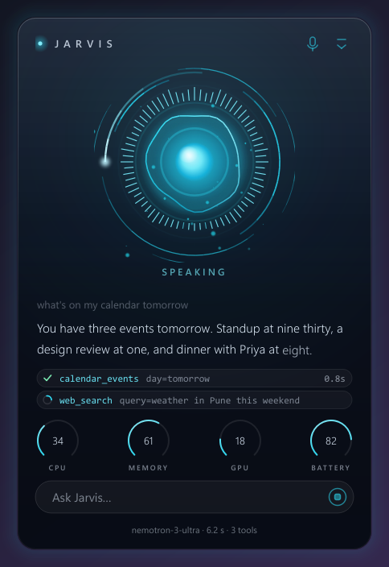
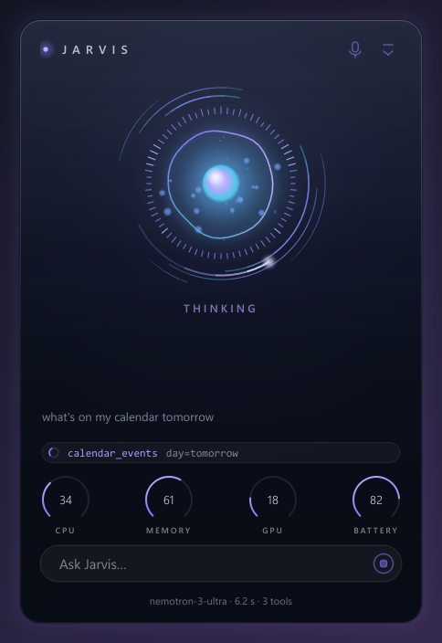
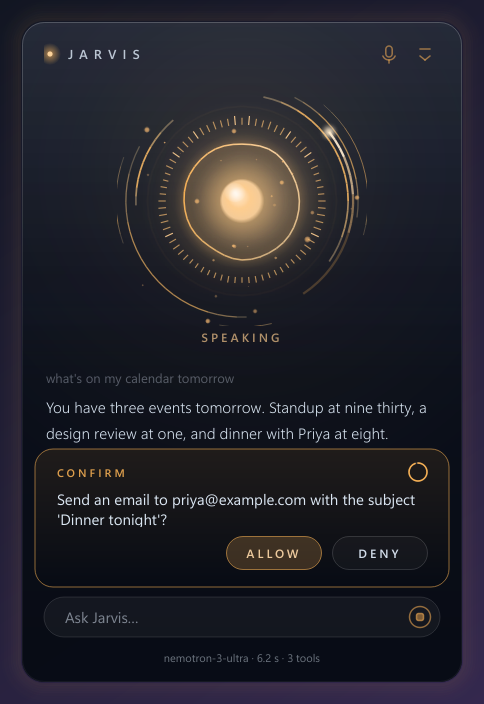

# Jarvis

[](https://github.com/Golden-alt933/Project-Jarvis-personal-project/actions/workflows/ci.yml)

<p align="center">
  
  
  
</p>

Jarvis is a personal desktop agent for Windows 11 and Linux. You talk to it in a terminal (or by voice, or through a small HUD window); a language model decides what to do and calls typed tools (files, shell, web, system, memory and so on) to do it. One agent loop handles every request, the whole conversation stays in context, and conversations and saved facts are kept in a local SQLite database so they survive restarts. The default brain is a hosted model behind an OpenAI-compatible API; a local Ollama model is available as a switchable option and as an automatic fallback.

Jarvis is a rebuild of an earlier project, Friday. See `docs/ARCHITECTURE.md` for the design and the reasons behind it.

## Supported platforms

| Area | Windows 11 | Linux, X11 session | Linux, Wayland session |
|---|---|---|---|
| Chat, memory, files, web, notes, reminders | yes | yes | yes |
| Hosted and local (Ollama) models, Ollama auto-start | yes | yes | yes |
| `run_command` | PowerShell | bash (`bash -lc`) | bash (`bash -lc`) |
| Open a file or URL | default handler | `xdg-open`, else `gio open` | same |
| Documents folders (Desktop, Documents, ...) | Windows shell (follows OneDrive) | `xdg-user-dir`, else `~/Name` | same |
| Open an app by name | Start Menu, Store apps, stock tools | `.desktop` files; `gtk-launch`, else the Exec line | same |
| List and close windows | yes | `wmctrl` | not supported (says so) |
| Volume, mute | yes | `wpctl`, else `pactl`, else `amixer` | same |
| Media keys | yes | `playerctl` | same |
| Lock screen | yes | `loginctl`, else `xdg-screensaver` | same |
| Clipboard | yes | needs `xclip` or `xsel` | needs `wl-clipboard` (or `xclip` via XWayland) |
| Screen capture, OCR, "look at screen" | yes | yes (`mss`); active monitor needs `xdotool` | `grim`, else `gnome-screenshot` (whole screen) |
| Foreground window title | yes | `xdotool` | not available |
| Camera (`look_through_camera`, `take_photo`) | yes (DirectShow; checked on a real webcam) | V4L2, implemented but not tried on a real camera | same |
| Desktop control: list controls of a window | yes (UI Automation) | not implemented (OCR clicks instead) | not implemented |
| Desktop control: click, type, keys, scroll, focus | yes (`SendInput`) | `xdotool` (mocked in tests, not tried live) | not supported (says so; `ydotool` could be added) |
| Voice mode | yes (optional NVIDIA GPU) | needs `libportaudio2` and a sound server | same |
| HUD window | yes | runs under Qt (see note) | not tried |
| Chrome control extension | yes | same extension | same |
| Documents (PDF, Word, Markdown) | yes | yes | yes |
| Excel recalculation | Excel (COM), else built-in evaluator | LibreOffice (`soffice`), else built-in evaluator | same |
| Delete to Recycle Bin / Trash | Recycle Bin | Trash | Trash |

What "yes" means here: on Windows, the author develops and uses Jarvis there. **The Linux column is implemented and covered by unit tests with the helper programs mocked, and by CI on Ubuntu (tests, installer, `jarvis --doctor`, and a HUD demo under a virtual display). It has not yet been tried on a real Linux desktop**, so expect rough edges with real microphones, sound servers, window managers and `.desktop` files. When a helper program is missing, the tool fails with a message that names the package to install.

macOS is not a target. Jarvis imports there, but anything that talks to the operating system returns a "not supported" failure.

Notes and gaps:

- Closing apps is graceful (it asks the window to close); Jarvis never kills processes.
- The HUD's global hotkey, "hide from screenshots" and acrylic effect are Windows-only and fail quietly elsewhere. Its Linux behaviour is only exercised by CI's offscreen tests and a scripted demo.
- A LibreOffice re-save can change styling that openpyxl never touched; Excel is preferred when both exist.
- GPU speech recognition needs the `gpu` extra and an NVIDIA GPU (Windows or x86-64 Linux). The Linux library loading for it is untested.
- PDF creation uses Arial or Segoe UI on Windows and DejaVu Sans on Linux if installed; otherwise the built-in fonts lack some symbols.

## Install

### One command

Linux:

```bash
curl -fsSL https://raw.githubusercontent.com/Golden-alt933/Project-Jarvis-personal-project/main/install.sh | bash
```

Windows (PowerShell):

```powershell
irm https://raw.githubusercontent.com/Golden-alt933/Project-Jarvis-personal-project/main/install.ps1 | iex
```

The scripts install [uv](https://docs.astral.sh/uv/) with Astral's official installer if it is missing (they tell you when they do), install Jarvis as a uv tool at a pinned release (`v0.1.0`), and then start `jarvis --setup`. Re-running a script upgrades. Python 3.13 is fetched by uv if you do not have it.

Options for `install.sh` (pass them after `bash -s --`, or save the file and run it): `--minimal` (no extras: text mode only), `--gpu` (add the NVIDIA CUDA libraries), `--ref <tag|branch|commit>`, `--system-deps`. For `install.ps1` set environment variables first, because `irm | iex` cannot take arguments: `JARVIS_REF`, `JARVIS_MINIMAL=1`, `JARVIS_GPU=1`; a saved script also takes `--minimal`, `--gpu`, `--ref`. `JARVIS_NO_SETUP=1` skips the setup step in both.

On Linux the script checks for system libraries and helpers (libportaudio2, xclip or wl-clipboard, wmctrl, playerctl, xdg-utils and the Qt xcb libraries the HUD needs) and **prints** the exact `apt`, `dnf`, `pacman` or `zypper` command for your distribution. It runs it only if you pass `--system-deps`, and then through `sudo` after showing the command. It never uses sudo on its own.

The same thing by hand, with uv installed:

```bash
uv tool install --python 3.13 "jarvis[all] @ git+https://github.com/Golden-alt933/Project-Jarvis-personal-project@v0.1.0"
```

Extras: `office` (documents, Excel), `screen` (capture, OCR), `browser` (Chrome bridge), `voice`, `hud`, `gpu` (CUDA libraries), and `all` (everything except `gpu`). To bump the release, change the one marked line (`JARVIS_DEFAULT_REF` / `$DefaultRef`) in each installer when you tag a new version.

### From source

```bash
git clone https://github.com/Golden-alt933/Project-Jarvis-personal-project
cd Project-Jarvis-personal-project
uv sync --all-extras     # or: uv sync --extra all  (without the CUDA libraries)
uv run jarvis --setup
```

Requirements: Python 3.13 and uv. An API key for one supported provider (NVIDIA, Groq, OpenRouter, Gemini, or any OpenAI-compatible endpoint), or [Ollama](https://ollama.com) for a fully local setup. A free NVIDIA key comes from <https://build.nvidia.com>.

## First run

```bash
jarvis --setup     # choose a provider, paste the key (hidden), optional name, then the doctor runs
jarvis --doctor    # a checklist with a one-line fix for each problem
jarvis             # chat
```

`--setup` writes the per-user config file (see below) with permissions only you can read where the OS supports them. The key is never echoed or logged. When stdin is not a terminal it asks nothing and prints what to put in the file instead. For a local setup choose "Ollama only", install Ollama and run `ollama pull qwen3:4b-instruct`.

`--doctor` checks the Python version, config file and key (the key is never printed), whether the hosted model answers (one tiny request, 15 s timeout; skip it with `--offline`), Ollama and the local model, which optional extras are installed, audio devices, speech models, GPU availability for speech, whether the Chrome extension is paired, and on Linux the helper programs. It exits with 0 unless something needed for text mode fails.

## Running

```bash
jarvis                              # interactive; resumes a conversation from the last 12 hours
jarvis --new                        # start a fresh conversation
jarvis --local                      # use the local Ollama model
jarvis --once "What time is it?"    # one turn, print the reply, exit
python -m jarvis                    # same as `jarvis`
```

(From a checkout, prefix with `uv run`.)

| Flag | Meaning |
|---|---|
| `--setup` | First-run setup (provider, key, name), then the doctor |
| `--doctor` | Check the installation and configuration |
| `--offline` | With `--doctor` or `--setup`: do not contact the hosted model |
| `--config-path` | Print the config file in use and exit |
| `--version` | Print the version and exit |
| `--local` | Use the local Ollama model as the main model |
| `--new` | Do not resume the latest conversation |
| `--once "text"` | Run a single turn non-interactively. Confirmations are denied unless `--yes` is given |
| `--yes` | Auto-approve confirmations (only honoured with `--once`) |
| `--provider NAME` | Override `JARVIS_PROVIDER` for this run |
| `--model ID` | Override `JARVIS_MODEL` for this run |
| `--verbose` | Show full tool arguments and a preview of each result |
| `--voice` | Voice mode (see below) |
| `--hud`, `--hud-demo`, `--no-voice` | The HUD window (see below) |
| `--devices` | List audio input/output devices and exit |
| `--browser-token` | Print the Chrome extension pairing token and folder, then exit |
| `--no-wake` | Voice mode: every utterance is addressed to Jarvis, no wake word needed |

If no key is configured, Jarvis says so, points to `jarvis --setup`, and exits with code 2.

### Slash commands

| Command | Action |
|---|---|
| `/help` | List commands |
| `/new` | Start a new conversation |
| `/local`, `/cloud` | Switch to the local model, or back to the configured cloud model |
| `/model` | Show the active model |
| `/tools` | List loaded tools by group, with their risk |
| `/memory` | List saved facts |
| `/forget <id>` | Delete a saved fact |
| `/exit` | Quit (also `exit`, `quit`, Ctrl+D) |

Ctrl+C during a reply cancels it and returns to the prompt. Alt+Enter inserts a newline; pasted multi-line text is sent as one message.

Tools marked `confirm` (deleting or overwriting files, most shell commands, and similar) show what they are about to do and ask `Allow? [y/N]`. The default is No. `run_command` runs without asking only for a single read-only command on a short allowlist (PowerShell cmdlets on Windows; `ls`, `cat`, `grep`, `find` without `-delete`/`-exec`, `git status`, and so on in bash); anything with `;`, `&&`, redirection, `$(...)`, `sudo` and the like asks first.

## Configuration

Settings are read in this order, first match wins:

1. environment variables,
2. `<repo>/.env`, only when running from a source checkout,
3. the per-user config file: `%APPDATA%\Jarvis\.env` on Windows, `${XDG_CONFIG_HOME:-~/.config}/jarvis/.env` on Linux.

`jarvis --config-path` prints the file in use. (`JARVIS_CONFIG_FILE` points Jarvis at a different per-user file; the test suite uses it.) Choose the provider and model with `JARVIS_PROVIDER` (`nvidia`, `groq`, `openrouter`, `gemini`, `ollama`, `custom`) and optionally `JARVIS_MODEL`; the defaults live in `jarvis/llm/providers.py`. A provider with no default model and no `JARVIS_MODEL` is a configuration error.

### Reference

<!-- config-table:start (every setting in jarvis/config.py; tests/test_readme.py checks this) -->
| Variable | Default | Meaning |
|---|---|---|
| `JARVIS_PROVIDER` | `nvidia` | `nvidia`, `groq`, `openrouter`, `gemini`, `ollama` or `custom` |
| `JARVIS_MODEL` | empty | Model id; empty uses the provider's default |
| `JARVIS_FAST_MODEL` | empty | Smaller model on the same provider for background jobs |
| `JARVIS_TEMPERATURE` | `0.3` | Sampling temperature |
| `JARVIS_MAX_OUTPUT_TOKENS` | `4096` | Maximum tokens per model reply |
| `JARVIS_REQUEST_TIMEOUT` | `90.0` | Seconds before a model request times out |
| `JARVIS_FIRST_BYTE_TIMEOUT` | `25.0` | A streaming request silent this long is retried once; 0 disables |
| `JARVIS_VOICE_MODEL` | empty | Faster model for voice and HUD (same provider); empty uses the default |
| `NVIDIA_API_KEY` | empty | Key for the `nvidia` provider |
| `GROQ_API_KEY` | empty | Key for `groq` |
| `OPENROUTER_API_KEY` | empty | Key for `openrouter` |
| `GEMINI_API_KEY` | empty | Key for `gemini` |
| `CUSTOM_BASE_URL` | empty | Base URL for `custom` (OpenAI-compatible) |
| `CUSTOM_API_KEY` | empty | Key for `custom` |
| `OLLAMA_BASE_URL` | `http://localhost:11434` | Ollama server |
| `OLLAMA_MODEL` | `qwen3:4b-instruct` | Local model |
| `OLLAMA_NUM_CTX` | `16384` | Local context window |
| `JARVIS_LOCAL_FALLBACK` | `true` | Fall back to the local model when the cloud is unreachable |
| `JARVIS_OLLAMA_AUTOSTART` | `true` | Start `ollama serve` (loopback only, once) when it is not running |
| `JARVIS_USER_NAME` | empty | What Jarvis calls you |
| `JARVIS_MAX_STEPS` | `25` | Tool-call steps per turn |
| `JARVIS_TURN_TIME_BUDGET` | `600.0` | Seconds per turn |
| `JARVIS_HISTORY_TOKEN_BUDGET` | `24000` | History is summarised above this many tokens |
| `JARVIS_TOOL_RESULT_MAX_CHARS` | `12000` | Tool results are truncated beyond this |
| `JARVIS_LOCAL_TOOL_GROUPS` | `core,files,web,memory` | Tool groups offered to a small local model |
| `JARVIS_WAKE_WORD` | `jarvis` | The word that addresses Jarvis |
| `JARVIS_REQUIRE_WAKE_WORD` | `true` | `false` treats every utterance as addressed (same as `--no-wake`) |
| `JARVIS_FOLLOWUP_SECONDS` | `10.0` | Follow-up window length |
| `JARVIS_END_SILENCE_MS` | `650` | Silence that ends an utterance |
| `JARVIS_BARGE_IN` | `vad` | `vad`, `wake` or `off` |
| `JARVIS_STT_MODEL` | `auto` | Whisper model: `auto`, `tiny.en`, `base.en`, `small.en`, ... |
| `JARVIS_STT_DEVICE` | `auto` | `auto`, `cuda` or `cpu` |
| `JARVIS_TTS_VOICE` | `en_GB-alan-medium` | Piper voice |
| `JARVIS_TTS_SPEED` | `1.0` | Speech speed multiplier |
| `JARVIS_INPUT_DEVICE` | empty | Microphone name or index; empty is the system default |
| `JARVIS_OUTPUT_DEVICE` | empty | Speaker name or index; empty is the system default |
| `JARVIS_VISION_PROVIDER` | `auto` | `auto`, `cloud` or `local`; `local` keeps images on this machine |
| `JARVIS_VISION_MODEL` | empty | Hosted vision model; empty uses the provider default |
| `OLLAMA_VISION_MODEL` | `qwen2.5vl:3b` | Local vision model |
| `JARVIS_CAMERA` | `ask` | Camera use: `ask` (confirm the first use in each session), `on` (never ask) or `off` |
| `JARVIS_CAMERA_INDEX` | empty | Camera number when the PC has several; empty uses the first that opens |
| `JARVIS_BROWSER_PORT` | `8765` | Loopback port for the Chrome extension bridge |
| `JARVIS_DATA_DIR` | empty | Data folder; empty uses the per-user default below |
<!-- config-table:end -->

### Where data and config live

| | Windows | Linux |
|---|---|---|
| Config file | `%APPDATA%\Jarvis\.env` | `${XDG_CONFIG_HOME:-~/.config}/jarvis/.env` |
| Data folder | `%LOCALAPPDATA%\Jarvis` | `${XDG_DATA_HOME:-~/.local/share}/jarvis` |

`JARVIS_DATA_DIR` overrides the data folder. It holds `jarvis.db` (conversations, summaries, facts; SQLite), `history.txt` (prompt history), `logs/jarvis.log` (rotating; keys and request bodies are never logged), `voices/` (speech voices), `browser-token` (Chrome pairing token) and `hud.json`. Whisper models are cached by Hugging Face under `~/.cache/huggingface` (or `HF_HOME`).

## Voice mode

```bash
jarvis --voice          # add --no-wake to skip the wake word
jarvis --devices        # find device names for JARVIS_INPUT_DEVICE / JARVIS_OUTPUT_DEVICE
```

Needs the `voice` extra (included by the installers unless `--minimal`). If it is missing, `--voice` prints the install command and exits with code 2. On Linux it also needs the system library `libportaudio2` and a running sound server; the doctor reports either problem. Speech models download on first use.

The microphone stays open for the whole session. Speech is detected locally, transcribed locally, and the transcript goes to the same agent as typed text; replies are spoken sentence by sentence while the model is still writing the rest. The terminal shows the state (idle, listening, thinking, speaking), live level meters, what was heard, the reply as it is spoken, and tool activity. Ctrl+C quits.

- **Model.** On NVIDIA, spoken and HUD turns use a smaller, faster model than text mode (`nvidia/nemotron-3.5-lightning-30b-a3b`, measured at about 1.5 s a step against 2.4 s, with the same pass rate on the tool-use checks). Set `JARVIS_VOICE_MODEL` to choose another, or set `JARVIS_MODEL` explicitly to use one model everywhere.
- **Wake word.** With `JARVIS_REQUIRE_WAKE_WORD=true` (the default) an utterance is only acted on if it contains the wake word, for example "Jarvis, what time is it?". Saying only "Jarvis" gets a "Yes?" and opens the follow-up window.
- **Follow-up window.** For `JARVIS_FOLLOWUP_SECONDS` after Jarvis finishes speaking you can answer without the wake word.
- **Stopping.** "Stop", "cancel", "never mind", "be quiet" or "shut up" cancels the current reply.
- **Confirmations.** Risky actions are asked aloud. Only a clear yes approves; anything else, silence for 15 seconds, or an unclear transcript means no.
- **Reminders.** Reminders are spoken when they fall due, once Jarvis is idle; in the text interface they are printed.
- **Barge-in** (`JARVIS_BARGE_IN`): `vad` (default) lets you interrupt by speaking, best with headphones; `wake` needs the wake word to interrupt (use it on loud speakers); `off` ignores the microphone while Jarvis speaks, except stop phrases.

## Chrome control

Jarvis can browse in your own Chrome, signed in as you, through the Jarvis Browser Control extension. It can open pages, read them, list their links, buttons and fields, click, type, fill forms, scroll, take screenshots and attach files. It only touches tabs in a cyan tab group named **JARVIS**.

The extension ships inside the installed package. Set up once:

1. Run `jarvis --browser-token`. It prints the pairing token and the extension folder.
2. Open `chrome://extensions`, turn on **Developer mode**, click **Load unpacked** and choose that folder.
3. Click the extension's toolbar icon, paste the token, leave the port at `8765` (match `JARVIS_BROWSER_PORT` if you changed it) and click **Save and connect**.

Jarvis listens on `127.0.0.1` only, for `chrome-extension://` origins, with the token required. Safety policy: reading, navigating, scrolling, clicking and typing run without asking; Jarvis asks before buying, paying, sending, posting, deleting, signing in, account changes, accepting terms and uploading files, and never types into password, card or one-time-code fields. Page text is treated as data, never as instructions.

## Documents, spreadsheets and the screen

Installed by the `office` and `screen` extras.

- **Documents:** read PDF, Word, Markdown and HTML; create Markdown, HTML, PDF or Word documents; merge, split, extract, rotate and fill PDFs. New files only: nothing existing is overwritten.
- **Excel:** overview, read ranges, write cells and formulas, append rows, create workbooks, column totals and lookups. Writes to an existing workbook ask first and keep a `.bak`. openpyxl cannot calculate formulas, so after a write the workbook is recalculated in a private hidden Excel (Windows, with pywin32), or by a headless LibreOffice on a temp copy (any OS with `soffice`), swapped in only if the result is valid. With neither, Jarvis's built-in evaluator calculates values when reading, and Excel stores them the next time the file is saved there.
- **Screen:** `read_screen_text` runs OCR locally. `look_at_screen` and `describe_image` send the image to a vision model: a hosted one on the configured key, falling back to the local Ollama vision model. Set `JARVIS_VISION_PROVIDER=local` to keep images on this machine.

## Camera

<!-- camera-section:start -->
Jarvis can look through the webcam: "what is this object?", "read the label on this bottle", "what is on my desk?". Installed by the `screen` extra (OpenCV).

- `look_through_camera(question, camera)` takes one picture and asks the vision model about it (the same hosted model as `look_at_screen`, `nvidia/nemotron-3.5-super-vl-120b-a12b` by default, falling back to local Ollama). The answer states which model replied and that the frame was sent to it. The frame is saved to `camera/last.jpg` in the data folder (overwritten each time) so an interface can show a thumbnail.
- `take_photo(save_to)` saves a full-resolution JPEG (default `Pictures\Jarvis\photo-<time>.jpg`, never overwriting). Nothing is sent to a model.
- `list_cameras` lists what opens. Set `JARVIS_CAMERA_INDEX` to pick a device.

The camera is switched on only for the moment of the capture (about 2 to 3 seconds including auto-exposure settling) and released straight away, so its light goes off; nothing is streamed or recorded. Capture takes the sharpest of a short burst and shrinks it to at most 1280 pixels on the long edge. Failures say what happened: no camera, camera in use by another app, camera access blocked (on Windows, the message names Settings > Privacy & security > Camera), or a black image from a closed lens cover.

Consent: with `JARVIS_CAMERA=ask` (the default) the first use in each session asks "Turn on the camera and send one frame to the vision model". A yes is remembered until Jarvis exits, a no is not. A yes to a plain photo does not cover sending a frame to a model. `on` never asks; `off` disables the tools. With `JARVIS_VISION_PROVIDER=local` the frame never leaves the machine.

What was verified: a real built-in webcam on Windows 11 (capture, sharpest-frame selection, release, and a real hosted-model answer). Not verified: Linux cameras, external or virtual cameras, several cameras at once.
<!-- camera-section:end -->

## Desktop control

<!-- desktop-section:start -->
Jarvis can act in desktop applications, not only see them. Order of preference: the app's **accessibility tree** first (reliable, no guessing from pixels), **OCR text** second (works in games, canvases and remote desktops), and raw coordinates are never offered to the model.

- `desktop_inspect` lists a window's controls (buttons, fields, checkboxes, menu items, tabs, links, list items, readouts such as a calculator display) with stable ref numbers, role, name, value and state.
- `desktop_click` clicks by ref (using the control's own action, such as Invoke or Toggle, and a real click at its centre only when no action exists) or, with `text=`, the on-screen text found by OCR. If several places match, it fails and lists them instead of guessing.
- `desktop_type` types real Unicode keystrokes (any language, any keyboard layout); `press_keys` presses chords such as `ctrl+s` or `alt+tab` and rejects unknown key names with the list of valid ones; `desktop_scroll`, `focus_window` and `get_active_window` complete the set.
- After each action the result says what changed: the foreground window before and after, the control's new value or state, and other controls that changed (for example the display after pressing equals), so the model checks instead of assuming.

Safety rules (screen content is data, never instructions):

- Buying, paying, sending, posting, deleting, signing in, accepting terms, account or security changes, and system actions such as shutting down or emptying the Recycle Bin ask you first.
- Password, credential and payment-card fields are refused outright; you type those yourself.
- Typing into, or pressing Enter in, a terminal, console, PowerShell or the Windows Run dialog asks first, with the text shown, because that runs commands.
- Closing and deleting chords (`alt+f4`, `ctrl+w`, `ctrl+shift+w`, `ctrl+q`, `delete`, `shift+delete`, `win+r`) ask first; `win+l` asks and then locks the screen. Ordinary navigation and editing chords do not ask.
- Jarvis's own windows, the Windows security desktop (UAC prompts, the lock screen) and administrator windows are never driven: a normal-rights Jarvis cannot control an elevated window, and says so.

Windows needs the `desktop` extra (`comtypes`, included in `all`). On Linux, input goes through `xdotool` on X11 (`sudo apt install xdotool`); a Wayland session is refused with a clear message (`ydotool` could be supported later). **Listing a window's controls is not implemented on Linux**: use `read_screen_text` and `desktop_click` with `text=` there. OCR clicks take roughly 20 seconds on a laptop CPU, so prefer controls from `desktop_inspect` where the app provides them.

What was verified: on Windows 11, Windows Calculator driven by ref (7 + 2 = 9), by typed keystrokes (12*3 = 36), by a real mouse click at a control's centre, and by an OCR text click, both directly and by the hosted model through the real agent. Everything else (the policy tables, key parsing, the UI Automation layer on a fake element tree, the Linux backend with `xdotool` mocked) is unit-tested. Not verified: Linux on a real desktop, administrator windows (the rule is unit-tested, not tried live), apps that expose no accessibility tree, and multiple monitors or mixed display scaling.
<!-- desktop-section:end -->

## HUD

A translucent, always-on-top glass interface with an orb that reacts to the microphone and speaker levels.

```bash
jarvis --hud            # HUD with voice
jarvis --hud --no-voice # HUD, typed requests only
jarvis --hud-demo       # scripted demo: no microphone, no model
```

Compact (orb and state word) and expanded (conversation, tool ticker, confirmation card, system gauges, text input) modes; click the orb or press **Ctrl+Alt+J** (Windows) to toggle; **Esc** cancels the current turn. The tray icon offers Show/Hide, mute, new conversation and Quit. The orb is always in motion and changes colour with the state (cyan standing by and speaking, violet while thinking, amber when asking before a risky action). Measured on a laptop at 125% display scale: about 20% of one CPU core while active, about 8% standing by, nothing while hidden. On Windows the window is excluded from screen capture by default. On Linux the HUD needs the Qt xcb libraries (the installer lists them); see the platform notes above.

## Privacy

- Every model call sends the conversation and tool results to the configured provider. Nothing else about your machine is sent unless a tool reads it and its result enters the conversation.
- `look_at_screen` and `describe_image` send the image to a hosted vision model unless `JARVIS_VISION_PROVIDER=local`.
- `look_through_camera` sends one webcam frame to the hosted vision model (after asking, by default) and keeps the last one at `camera/last.jpg` in the data folder; `JARVIS_CAMERA=off` disables the camera tools.
- OCR, speech recognition and speech synthesis run locally (models are downloaded once from their hosts).
- Keys live in environment variables or the config files above and are never logged. The doctor and setup never print them.
- To keep everything on the machine: `JARVIS_PROVIDER=ollama` (or `jarvis --local`), `JARVIS_VISION_PROVIDER=local`. Web search and page-reading tools still reach the internet when you use them.
- Memory (facts, conversations) is a local SQLite file; `/memory` lists it and `/forget <id>` deletes an entry.

## Troubleshooting

| Symptom | What to do |
|---|---|
| "Jarvis is not configured" | `jarvis --setup`, then `jarvis --doctor` |
| `jarvis: command not found` after installing | The tool folder is not on PATH: run `uv tool update-shell` and open a new terminal |
| Hosted model unreachable | `jarvis --doctor` shows the HTTP status; check the key and network, or use `jarvis --local` |
| Ollama "not running" | `ollama serve`, then `ollama pull qwen3:4b-instruct` |
| Voice: no devices, or PortAudio errors on Linux | Install `libportaudio2`, make sure PipeWire or PulseAudio runs, check `jarvis --devices` |
| "not supported in a Wayland session" | Listing and closing windows needs X11 and `wmctrl`; log in with an X11 session |
| "install wmctrl" (or another package) | The message names the package; install it with your package manager |
| HUD does not start on Linux | `jarvis --doctor` and the installer list the Qt xcb libraries; install them |
| Chrome says the extension cannot connect | Jarvis must be running (the bridge starts with it). Re-run `jarvis --browser-token`, paste the token again, and check the port matches |
| Chrome extension behaves oddly after an update | Open `chrome://extensions` and click the reload arrow on Jarvis Browser Control |
| Jarvis cuts itself off when speaking through laptop speakers | Use headphones, or set `JARVIS_BARGE_IN=wake` |
| Voice replies are slow | The free hosted tier queues requests; Jarvis says a short filler after 2.5 s. `jarvis --doctor` shows whether speech recognition is on the GPU |

Logs are in the data folder under `logs/jarvis.log`.

## Uninstall

```bash
uv tool uninstall jarvis
```

This removes the program. Your data stays until you delete it: the config file and data folder listed under "Where data and config live" (conversations, saved facts, voices, the Chrome pairing token). Remove the Chrome extension from `chrome://extensions`. `uv` itself stays installed.

## Development

```bash
uv sync --all-extras
uv run pytest -q
```

CI (`.github/workflows/ci.yml`) runs the suite on Ubuntu and Windows with Python 3.13, runs `shellcheck install.sh`, and in a second job runs the real installers on clean runners (`jarvis --version`, `jarvis --doctor --offline`, and on Ubuntu `jarvis --hud-demo` under a virtual display). The Linux tests mock the helper programs, so they check parsing and fallbacks rather than a real desktop. Tests that cannot run on an OS are skipped with a reason (for example Windows file-sharing modes, or SAPI speech synthesis).

Project layout:

```
jarvis/
  config.py        Settings and config lookup
  doctor.py        jarvis --doctor
  setup_wizard.py  jarvis --setup
  platform/        OS backends: windows.py, linux.py, base.py (the contract)
  llm/             Provider clients: OpenAI-compatible and native Ollama
  tools/           @tool decorator, registry, builtin/ tool modules
  memory/          SQLite store
  agent/           The agent loop, prompt, context compaction, events
  interfaces/      app.py (wiring), cli.py, voice.py, hud.py
  voice/ vision/ browser/ hud/ proactive/
extensions/jarvis-browser-control/   Chrome extension (also packaged inside the wheel)
install.sh, install.ps1              One-command installers
```

### Adding a tool

A tool is a typed function in `jarvis/tools/builtin/`. The JSON schema the model sees is generated from the signature and docstring; every module in that folder is loaded at startup. Anything that differs between operating systems goes through `jarvis.platform.current()`, never `sys.platform` checks in the tool.

```python
# jarvis/tools/builtin/greeting.py
from jarvis.tools.base import ToolResult, tool


@tool(group="core")
async def word_count(text: str) -> ToolResult:
    """Count the words in a piece of text.

    Args:
        text: The text to count words in.
    """
    return ToolResult.success(f"{len(text.split())} words")
```

`ctx` (a `ToolContext`) is injected and hidden from the model. Use `risk=Risk.CONFIRM` for anything destructive or arbitrary. Return `ToolResult.fail(error, hint=...)` for expected failures. See `jarvis/tools/base.py` for the full rules.

## Roadmap

- Try the Linux backend on real desktops (X11 and Wayland) and fix what that finds
- Window listing on Wayland compositors
- Listing the controls of desktop apps on Linux (AT-SPI), and input on Wayland (`ydotool`)
- Email and calendar

## Credits

Parts of the capability code are ported from the MIT-licensed Friday project (copyright JARVIS Dev Team).
